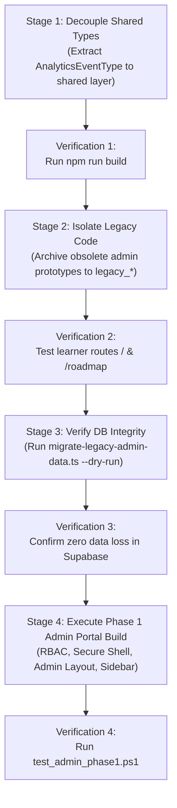

# Admin Portal Removal & Architecture Audit — Tiếng Hàn JungHyeon

**Document Version:** 1.0.0  
**Audit Date:** 2026-11-02  
**Target Architecture:** Strict Isolation between Learner Web (`src/app/(learner)/**`) and Admin Portal (`src/app/[locale]/(admin)/admin/**`).

---

## 1. Inventory of Admin Artifacts in the Codebase

This section inventories every file, route, component, hook, type, and translation key currently belonging to the admin infrastructure.

### 1.1 Routes & Pages
| Path | Type | Purpose | Status |
| :--- | :--- | :--- | :--- |
| `src/app/[locale]/(admin)/admin/layout.tsx` | Layout | Admin layout shell with `AdminAuthProvider`, `AdminSidebar`, `AdminHeader` | Active (Phase 1 baseline) |
| `src/app/[locale]/(admin)/admin/page.tsx` | Page | Admin main dashboard with KPI metrics, draft queue, leads, audit log | Active (Phase 1 baseline) |
| `src/app/[locale]/(admin)/admin/login/page.tsx` | Page | Admin login form with role switcher & credential authentication | Active (Phase 1 baseline) |
| `src/app/[locale]/(admin)/admin/unauthorized/page.tsx` | Page | 403 Forbidden screen when user lacks required RBAC permissions | Active (Phase 1 baseline) |
| `src/middleware.ts` | Middleware | Handles subdomain rewrite (`admin.<domain>`) and path rewrite `/admin` -> `/[locale]/admin` | Active |

### 1.2 API Routes
| Endpoint | Method | Purpose | Consumer |
| :--- | :--- | :--- | :--- |
| `src/app/api/revalidate/route.ts` | `POST` | Secured cache invalidation (`x-revalidate-secret`) for published content | Admin CMS Publisher |
| `src/app/api/analytics/route.ts` | `POST` | Event ingestion endpoint writing to `public.analytics_events` | Learner App & Admin Analytics |
| `src/app/api/ai/honey/route.ts` | `POST` | Streaming AI assistant backend | Learner App & Admin Assistant |

### 1.3 UI Components (`src/components/admin/`)
| Component | File Path | Dependencies | Status |
| :--- | :--- | :--- | :--- |
| `AdminBreadcrumbs` | `src/components/admin/AdminBreadcrumbs.tsx` | Next.js `usePathname` | Admin-only |
| `AdminHeader` | `src/components/admin/AdminHeader.tsx` | `useAdminAuth`, `NotificationBell`, `BrandLogo` | Admin-only |
| `AdminSidebar` | `src/components/admin/AdminSidebar.tsx` | `useAdminAuth`, `BrandLogo`, Lucide icons | Admin-only |
| `NotificationBell` | `src/components/admin/NotificationBell.tsx` | `AdminNotification` type, Supabase Realtime | Admin-only |
| `RbacGuard` | `src/components/admin/RbacGuard.tsx` | `useAdminAuth`, `AdminPermission` | Admin-only |
| `StatCard` | `src/components/admin/StatCard.tsx` | Lucide icons | Admin-only |

### 1.4 Business Logic & RBAC Hooks (`src/features/auth-rbac/`)
| Module | File Path | Exports |
| :--- | :--- | :--- |
| `AdminAuthContext` | `src/features/auth-rbac/AdminAuthContext.tsx` | `AdminAuthProvider`, `useAdminAuth` |
| `permissions` | `src/features/auth-rbac/permissions.ts` | `ROLE_DEFINITIONS`, `hasPermission()`, `canAccessRoute()` |
| `types` | `src/features/auth-rbac/types.ts` | `AdminRole`, `AdminPermission`, `RoleDefinition` |
| `tracker` | `src/features/analytics/tracker.ts` | `trackAnalyticsEvent()`, `AnalyticsEventPayload` |

### 1.5 TypeScript Definitions
| File Path | Types Defined |
| :--- | :--- |
| `src/types/admin.types.ts` | `AdminUserSession`, `AdminNotification`, `AnalyticsEventType`, `AdminKpiSummary` |
| `src/types/database.types.ts` | `admin_roles`, `admin_permissions`, `role_permissions`, `admin_users`, `audit_logs`, `content_versions`, `content_reports`, `analytics_events`, `system_settings` |

### 1.6 Localization Keys (`messages/vi.json` & `messages/en.json`)
The following keys are defined under `"admin.*"`:
- `admin.portalBadge`: "Admin Portal"
- `admin.exportCsv`: "Xuất báo cáo CSV" / "Export CSV Report"
- `admin.backToStudentWeb`: "Về website học viên" / "Back to Learner Web"
- `admin.newStudentsWeek`: "Học viên mới tuần này" / "New Students This Week"
- `admin.weeklyRevenue`: "Doanh thu tuần" / "Weekly Revenue"
- `admin.newLeads`: "Lead tư vấn mới" / "New Consultation Leads"
- `admin.completionRate`: "Tỉ lệ hoàn thành bài" / "Lesson Completion Rate"
- `admin.leadsTab`: "Quản lý Leads" / "Leads Management"
- `admin.ordersTab`: "Đơn hàng" / "Orders"
- `admin.lessonsTab`: "Bài học & Import CSV" / "Lessons & CSV Import"
- `admin.couponsTab`: "Mã giảm giá" / "Coupons & Discounts"
- `admin.publishing`: "Duyệt & Xuất bản" / "Publishing & Review"
- `admin.auditLogs`: "Nhật ký Hoạt động" / "Audit Logs"
- `admin.systemSettings`: "Cài đặt Hệ thống" / "System Settings"
- `admin.rbacRole`: "Vai trò phân quyền" / "RBAC Role"
- `admin.notifications`: "Thông báo Quản trị" / "Admin Notifications"
- `admin.unauthorizedTitle`: "Không có quyền truy cập" / "Access Denied (403)"
- `admin.unauthorizedDesc`: "Vai trò của bạn không có quyền..." / "Your role does not have permission..."

### 1.7 Scripts & Testing Utilities
- `scripts/migrate-legacy-admin-data.ts`: Idempotent data migration script for `legacy_*` tables.
- `scripts/test_admin_phase1.ps1`: Automated route status code and security guard verification.

---

## 2. Learner Site Import & Link Analysis

To guarantee that removing or modifying admin code never causes runtime or build regressions on the learner portal, every cross-boundary interaction has been audited and classified:

| Source File (Learner / Shared) | Reference / Import | Purpose | Classification | Action Required |
| :--- | :--- | :--- | :--- | :--- |
| `src/components/shared/BrandLogo.tsx` | Prop `adminBadge?: boolean` | Allows rendering "Admin" badge when used inside admin sidebar/login | **shared (must keep or move)** | Keep in `src/components/shared/BrandLogo.tsx`. Clean & decoupled. |
| `src/components/ui/FloatingActions.tsx` | `POST /api/analytics` (`event_type: "content_reported"`) | Submits user bug reports to `content_reports` | **shared (must keep or move)** | Keep. API route is decoupled via HTTP POST. |
| `src/features/analytics/tracker.ts` | `import type { AnalyticsEventType } from "@/types/admin.types"` | Type definition for event names | **shared (must keep or move)** | Move `AnalyticsEventType` into `src/types/analytics.types.ts` so learner doesn't import from `admin.types.ts`. |
| `src/lib/supabase.ts` | `getServiceSupabase()` | Privileged service client for server routes | **shared (must keep or move)** | Keep in `src/lib/supabase.ts`. |
| `src/middleware.ts` | Rewrite rules for `/admin` and `admin.<domain>` | Re-routes admin requests to `/[locale]/(admin)/admin` | **admin-only (safe to delete or maintain)** | Keep in `middleware.ts` to isolate subdomain routing. |
| `src/app/robots.ts` | `disallow: ["/admin", "/api/"]` | Disallows web search crawlers from indexing admin routes | **shared (must keep or move)** | Keep. Essential for search engine hygiene. |
| `.eslintrc.json` | `no-restricted-imports` pattern for `(admin)` | Build-time barrier preventing learner site from importing admin code | **shared (must keep or move)** | Keep. Essential architectural guardrail. |

> [!NOTE]
> **Audit Finding**: Currently, `src/app/(learner)/**` has **ZERO** direct imports from `src/app/[locale]/(admin)/**` or `src/components/admin/**`. The separation boundary is strictly respected.

---

## 3. Database Objects Audit & Classification

The Supabase PostgreSQL schema was audited against both learner requirements and admin operations:

| Object Name | Object Type | Used by Learner? | Used by Admin? | Holds Data? | Classification | Recommendation & Action |
| :--- | :--- | :--- | :--- | :--- | :--- | :--- |
| `admin_roles` | Table | No | Yes (RBAC) | Yes (5 roles) | **MIGRATE** | Keep for Admin Phase 1 RBAC system. |
| `admin_permissions` | Table | No | Yes (RBAC) | Yes (11 permissions) | **MIGRATE** | Keep for Admin Phase 1 RBAC system. |
| `role_permissions` | Table | No | Yes (RBAC) | Yes (mappings) | **MIGRATE** | Keep for Admin Phase 1 RBAC system. |
| `admin_users` | Table | No | Yes (Staff) | Yes (dev accounts) | **MIGRATE** | Keep for staff authentication. |
| `audit_logs` | Table | No | Yes (Audit trail) | Yes (dev entries) | **MIGRATE** | Keep for system compliance tracking. |
| `content_versions` | Table | Yes (via FK) | Yes (CMS draft/publish) | Yes (lesson drafts) | **KEEP** | **CRITICAL**: Source of truth for draft/published lesson versions. |
| `lessons.published_version_id` | Column | Yes (reads live) | Yes (updates on publish) | Yes | **KEEP** | Ensures learner site only sees approved published content. |
| `lessons.status` | Column | Yes (filters) | Yes (publishes) | Yes | **KEEP** | `'published'` filter prevents draft leakage. |
| `content_reports` | Table | Yes (Learner writes) | Yes (Admin resolves) | Yes (bug reports) | **KEEP** | Learner "Báo lỗi" button writes tickets here; admin inbox consumes it. |
| `analytics_events` | Table | Yes (Learner writes) | Yes (Admin aggregates) | Yes (clickstream) | **KEEP** | Ingestion table for platform KPIs and retention analysis. |
| `system_settings` | Table | Yes (Reads flags) | Yes (Admin updates) | Yes (4 seed rows) | **KEEP** | Stores maintenance mode, feature flags, and gamification multipliers. |
| `legacy_lessons` | Table | No | Migration script | Optional | **MIGRATE** | Read-only in `migrate-legacy-admin-data.ts`. Drop only after user confirmation. |
| `legacy_vocab` | Table | No | Migration script | Optional | **MIGRATE** | Read-only in `migrate-legacy-admin-data.ts`. Drop only after user confirmation. |
| `legacy_leads` | Table | No | Migration script | Optional | **MIGRATE** | Read-only in `migrate-legacy-admin-data.ts`. Drop only after user confirmation. |

---

## 4. Environment Variables, Dependencies & Edge Functions

### 4.1 Environment Variables
| Variable | Used By | Required on Learner? | Required on Admin? | Action |
| :--- | :--- | :--- | :--- | :--- |
| `REVALIDATION_SECRET` | Revalidation route | No | Yes | Keep in `.env.local` / Vercel secrets. |
| `SUPABASE_SERVICE_ROLE_KEY` | Server-side mutations | No | Yes | Keep protected on server-side only. |
| `TELEGRAM_BOT_TOKEN` | Instant lead alerts | No | Yes | Keep for CRM lead notifications. |
| `TELEGRAM_CHAT_ID` | Instant lead alerts | No | Yes | Keep for CRM lead notifications. |
| `RESEND_API_KEY` | Email dispatches | No | Yes | Keep for advisor email delivery. |
| `NEXT_PUBLIC_ADMIN_BASE_URL` | Subdomain routing | No | Yes | Keep for optional `admin.junghyeon.vn`. |

### 4.2 Dependencies in `package.json`
- **Zero orphaned dependencies**: Every installed dependency (`framer-motion`, `lucide-react`, `next-themes`, `canvas-confetti`, `@supabase/supabase-js`, `clsx`, `tailwind-merge`) is actively utilized across both the learner site and admin UI components.
- No bulky admin-only packages (e.g. heavy charting libraries) have been installed in `package.json` yet. Lightweight SVG-based micro-charts and CSS indicators are used instead.

### 4.3 Cron & Edge Functions
- No third-party standalone cron functions or edge daemons currently exist.
- Scheduled tasks (e.g. daily streak evaluation and analytics aggregation) will run via standard Supabase Database Webhooks / pg_cron or Vercel Cron.

---

## 5. Dependency Graph & Risk Assessment

### 5.1 Architecture Dependency Graph
```
┌────────────────────────────────────────────────────────────────────────┐
│                          Database (PostgreSQL)                         │
│  ┌───────────────────────┐                  ┌───────────────────────┐  │
│  │   content_versions    │                  │   analytics_events    │  │
│  │   system_settings     │                  │   content_reports     │  │
│  └───────────▲───────────┘                  └───────────▲───────────┘  │
└──────────────┼──────────────────────────────────────────┼──────────────┘
               │ (Reads status='published')               │ (Emits events & reports)
      ┌────────┴─────────────┐                   ┌────────┴─────────────┐
      │  Learner Web Portal  │                   │     Shared Layer     │
      │  src/app/(learner)   │                   │  - src/lib           │
      │                      │                   │  - src/features      │
      │                      │                   │  - src/types         │
      └──────────────────────┘                   └────────▲─────────────┘
                                                          │
                                                 ┌────────┴─────────────┐
                                                 │     Admin Portal     │
                                                 │ src/app/[locale]/    │
                                                 │   (admin)/admin      │
                                                 └──────────────────────┘
```

### 5.2 Risk Assessment Table
| Risk ID | Potential Breaking Action | Severity | Impact on Learner Site | Mitigation Strategy |
| :--- | :--- | :--- | :--- | :--- |
| **R-1** | Accidental deletion of `content_versions` or `lessons.published_version_id` | **HIGH** | Lessons could fail to resolve draft/published content fallback | Preserve `content_versions` table and keep column in all queries. |
| **R-2** | Deletion of `/api/analytics` endpoint | **MEDIUM** | `FloatingActions.tsx` error when learners submit feedback | Keep endpoint functional with graceful fallback (`console.warn`) if offline. |
| **R-3** | Deletion of `system_settings` | **MEDIUM** | Maintenance gate & feature flags fail open or throw errors | Maintain default JSON values in code when DB row is missing. |
| **R-4** | Importing admin types into learner code | **LOW** | Potential build failure under `no-restricted-imports` | Decouple `AnalyticsEventType` into a dedicated `src/types/analytics.types.ts`. |

---

## 6. Proposed Ordered Deletion & Migration Plan

To maintain zero downtime and continuous compilation (`npm run build` code 0) at all times:



### Stage 1: Decouple Shared Types
- Move `AnalyticsEventType` from `src/types/admin.types.ts` into a dedicated shared file `src/types/analytics.types.ts`.
- Update `src/features/analytics/tracker.ts` to import from the new shared location.
- **Verification**: Run `npm run build` to confirm 0 compilation errors.

### Stage 2: Archive Deprecated Prototypes
- Confirm that no files in `src/app/(learner)` reference legacy admin paths.
- Ensure all admin routes remain strictly encapsulated under `src/app/[locale]/(admin)/admin/**`.
- **Verification**: Check ESLint boundary rules with `npm run lint`.

### Stage 3: Database & Legacy Data Check
- Execute `npx ts-node scripts/migrate-legacy-admin-data.ts --dry-run`.
- Verify that lessons, vocabulary, and lead records map seamlessly into the new schema without dropping any `legacy_*` tables.
- **Verification**: Confirm dry-run report outputs 0 unhandled failures.

### Stage 4: Admin Portal Phase 1 Delivery
- Proceed to implement **Admin Phase 1** (Core Admin Shell, RBAC Session Switcher, Live KPI Summary, Breadcrumbs, and Audit Log Monitor) following the approved architecture.
- **Verification**: Execute `scripts/test_admin_phase1.ps1` and verify all integration assertions return HTTP 200 / HTTP 401.

---
*End of Audit. Awaiting user approval to proceed with Phase 1 execution.*
