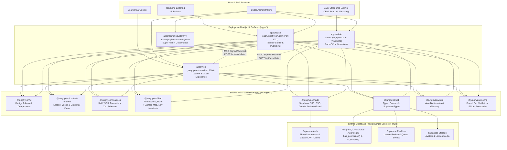
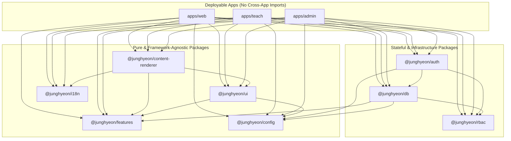
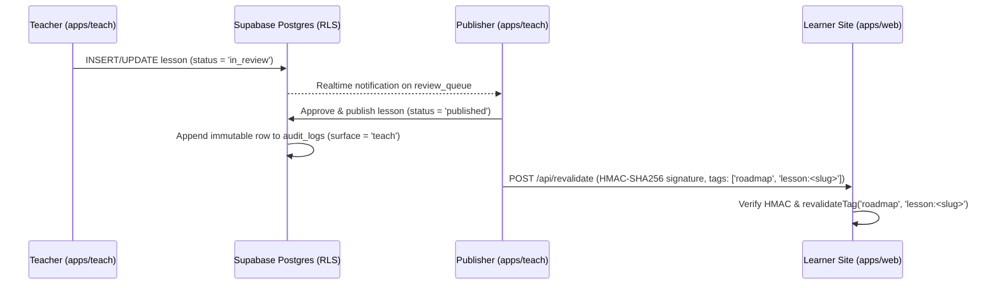

# Turborepo Multi-Surface Monorepo Architecture

> **Project**: Tiếng Hàn JungHyeon  
> **Architecture Pattern**: 3 Isolated Next.js 14 App Router Surfaces + 9 Shared Workspace Packages + 1 Unified Supabase Backend

---

## 1. High-Level Topology (Mermaid Diagram)

---

## 2. Package Dependency Graph & Strict Import Boundaries

### Enforced Boundary Rules (`eslint-plugin-boundaries` + CI Bundle Gate)
1. **No Cross-App Imports**: `apps/web`, `apps/teach`, and `apps/admin` can **never** import from one another.
2. **Pure Package Isolation**: `@junghyeon/ui`, `@junghyeon/content-renderer`, and `@junghyeon/features` must **never** import from `@junghyeon/auth`, `@junghyeon/db`, or any `apps/*`.
3. **Zero Leakage to Learner Bundle**:
   - `apps/web` and `apps/teach` bundles are scanned in CI for forbidden module identifiers and strings (`revenue`, `refund-approval`, `payment-keys`, `impersonation`, `roles-matrix`, `SUPABASE_SERVICE_ROLE_KEY`).
   - All financial reconciliation, refund approvals, role matrix mutations, and payment gateway keys live exclusively inside `apps/admin`.

---

## 3. Cross-Surface Event & Revalidation Architecture

Apps never call each other's internal code or share in-memory state. All cross-surface workflows flow through **PostgreSQL + Supabase Realtime** and **HMAC-signed webhooks**:

---

## 4. Database & Surface-Aware Row-Level Security (RLS)

1. **`surface_type` Enum**: `('web', 'teach', 'admin', 'system')`.
2. **`role_surfaces` Table**: Maps each `CanonicalRole` to its permitted surfaces (`default-deny`).
3. **RLS Helper Functions**:
   - `public.current_surface()`: Reads the request surface claim/header validated against `role_surfaces`.
   - `public.in_surface(target_surface surface_type)`: Returns `true` only if the authenticated user's role is permitted on `target_surface`.
   - `public.has_permission(resource text, action text)`: Evaluates whether the caller's active role grants `resource:action` on the current surface.
   - `public.is_super_admin()`: Returns `true` only for active `super_admin` accounts.
4. **Defense-in-Depth**: Even if a `teacher` extracts their valid JWT and queries Supabase REST/PostgREST directly for `orders`, `leads`, or `payment_settings`, PostgreSQL RLS rejects the query because `teacher` lacks both the surface grant (`admin`/`system`) and the permission grant.
