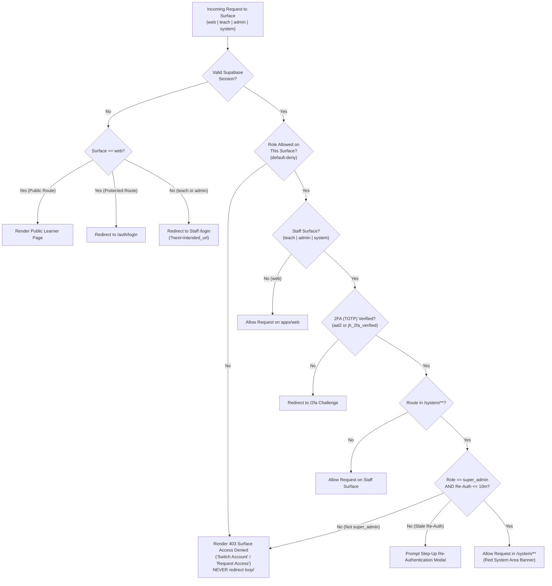

# Single Sign-On (SSO), Surface Guards & Step-Up Authentication

> **Package**: `@junghyeon/auth` (`packages/auth`) & `@junghyeon/rbac` (`packages/rbac`)  
> **Backend**: Single Shared Supabase Auth Project (`auth.users`)

---

## 1. Cross-Subdomain SSO Cookie Architecture

All three surfaces (`junghyeon.com`, `teach.junghyeon.com`, `admin.junghyeon.com`) share a single Supabase authentication session using parent-domain cookies:

| Cookie Parameter | Production (`*.junghyeon.com`) | Staging (`*.staging.junghyeon.com`) | Local Development (`localhost:3000/3001/3002`) |
| :--- | :--- | :--- | :--- |
| **`Domain`** | `.junghyeon.com` (`TODO: confirm final domain`) | `.staging.junghyeon.com` | Omitted / `localhost` (shared across ports `3000`, `3001`, `3002` per RFC 6265) |
| **`Path`** | `/` | `/` | `/` |
| **`HttpOnly`** | `true` | `true` | `true` |
| **`Secure`** | `true` | `true` | `false` (`http://localhost`) |
| **`SameSite`** | `Lax` | `Lax` | `Lax` |
| **Access Token TTL** | 15 minutes (auto-rotated via refresh token) | 15 minutes | 15 minutes |

### Local Development Multi-Port SSO (`localhost:3000`, `3001`, `3002`)
Per RFC 6265 §8.5, cookies set on `localhost` without a port restriction are shared across all ports on `localhost`. Additionally, `@junghyeon/auth` includes a development SSO handoff endpoint (`/api/auth/sso-handoff`) so testing across `web.localhost:3000`, `teach.localhost:3001`, and `admin.localhost:3002` works seamlessly even in strict browser profiles.

---

## 2. Authentication & Surface Guard Flow

---

## 3. JWT Custom Claims vs. Server-Side DB Authority

1. **Custom Access Token Hook (`supabase/migrations`)**:
   - Injects `app_metadata.role` (e.g. `"teacher"`) and `app_metadata.surfaces` (e.g. `["web", "teach"]`) into the JWT for fast edge middleware checks.
2. **DB Re-Verification on Sensitive Operations**:
   - JWT claims are treated strictly as a **routing cache, never the final authority**.
   - Every Server Action, API Route, and `SECURITY DEFINER` RPC re-queries `user_roles` and `role_permissions` in PostgreSQL before executing any mutation or returning sensitive data.
   - If a staff member's role is revoked or downgraded in `/system/staff`, all subsequent server actions fail immediately even before their 15-minute access token expires.

---

## 4. Session Security, Idle Timeouts & Impersonation

| Control | `apps/web` (Learner) | `apps/teach` (Teacher Studio) | `apps/admin` (Back-Office) | `apps/admin` (`/system/**`) |
| :--- | :--- | :--- | :--- | :--- |
| **Idle Timeout** | None (Persistent 30d) | **30 minutes** | **30 minutes** | **15 minutes** |
| **Step-Up Re-Auth** | On password/email change | On bulk delete | On refund approval | **Mandatory every 10 minutes** |
| **CSRF Protection** | Origin + Custom Header check | Origin + CSRF Token | Origin + CSRF Token | Origin + CSRF Token |
| **Global Sign-Out** | `/profile/settings/account` ("Sign out of all devices") | Staff Account Menu | Staff Account Menu | Can revoke any user's sessions |
| **Impersonation** | Target of read-only view | Target of read-only view | Forbidden | `super_admin` only, **read-only**, **15-min hard expiry**, every page view logged to `audit_logs` |

---

## 5. Non-Indexability & Security Headers for Staff Surfaces (`teach` & `admin`)

Every response from `apps/teach` and `apps/admin` includes:
- `X-Robots-Tag: noindex, nofollow, noarchive, nosnippet`
- `Content-Security-Policy: default-src 'self'; frame-ancestors 'none'; base-uri 'self'; form-action 'self'`
- `X-Frame-Options: DENY`
- `X-Content-Type-Options: nosniff`
- `Referrer-Policy: strict-origin-when-cross-origin`
- `Permissions-Policy: camera=(), geolocation=(), payment=()`
- Zero third-party marketing pixels or learner analytics trackers.
