# Database Documentation — JungHyeon Korean (정현)

This document provides a comprehensive specification of the Supabase PostgreSQL database architecture for the JungHyeon Korean learning platform.

---

## 1. Architecture Overview

The database uses PostgreSQL on Supabase with Row Level Security (RLS) enabled across tables, ensuring high security and data isolation.

- **Primary Authentication**: Supabase Auth (`auth.users`)
- **Number of Tables**: 20 core tables
- **Naming Standard**: Strict English naming conventions (`snake_case` for columns, plural nouns for tables)
- **Data Protection**: Zero data loss database migrations with idempotent scripts (`IF EXISTS` / `DO $$`)

```mermaid
erDiagram
    profiles ||--o{ user_progress : tracks
    profiles ||--o{ user_xp_log : logs
    profiles ||--o{ decks : owns
    profiles ||--o{ card_reviews : reviews
    profiles ||--o{ streaks : maintains
    profiles ||--o{ user_badges : unlocks
    profiles ||--o{ orders : places
    profiles ||--o{ topik_attempts : attempts
    profiles ||--|| notification_preferences : configures
    profiles ||--o{ profile_change_log : records_audit
    profiles ||--o{ data_export_requests : requests_export
    profiles ||--o{ account_deletion_requests : requests_deletion
    countries ||--o{ profiles : references_nationality
    vn_provinces ||--o{ profiles : references_location
    levels ||--o{ lessons : contains
    lessons ||--o{ lesson_blocks : structures
    lessons ||--o{ vocab : provides
    lessons ||--o{ exercises : assesses
    lessons ||--o{ lesson_submissions : submitted_for_review
    lessons ||--o{ lesson_comments : has_feedback
    lessons ||--o{ lesson_tag_links : tagged_with
    lesson_tags ||--o{ lesson_tag_links : categorized_by
    lessons ||--o{ lesson_grammar_points : teaches_grammar
    grammar_points ||--o{ lesson_grammar_points : included_in
    lessons ||--o{ lesson_vocabulary_items : teaches_vocab
    vocabulary_items ||--o{ lesson_vocabulary_items : included_in
    profiles ||--o{ teacher_content_scopes : authorized_scope
    decks ||--o{ cards : contains
    cards ||--o{ card_reviews : logs
    badges ||--o{ user_badges : references
    products ||--o{ orders : purchased
    topik_tests ||--o{ topik_attempts : evaluates
```

---

## 2. Table Specifications

### 2.1 User & Identity

#### `public.profiles`
Stores extended user profile information linked directly to Supabase Auth.
- `id` (UUID, PK, FK -> `auth.users.id` ON DELETE CASCADE)
- `email` (TEXT, UNIQUE, NOT NULL)
- `full_name` (TEXT, 2-60 chars)
- `display_name` (TEXT, UNIQUE, 3-24 chars, citext)
- `avatar_url` (TEXT)
- `avatar_kind` (TEXT, DEFAULT `'preset'`): `'upload'` | `'preset'`
- `gender` (TEXT, DEFAULT `'undisclosed'`): `'male'` | `'female'` | `'other'` | `'undisclosed'`
- `date_of_birth` (DATE, age 8-100)
- `nationality_code` (TEXT, ISO 3166-1 alpha-2, DEFAULT `'VN'`)
- `country_code` (TEXT, ISO 3166-1 alpha-2, DEFAULT `'VN'`)
- `province_code` (TEXT, FK -> `public.vn_provinces.code`)
- `ui_language` (TEXT, DEFAULT `'vi'`): `'vi'` | `'en'`
- `timezone` (TEXT, DEFAULT `'Asia/Ho_Chi_Minh'`)
- `phone_e164` (TEXT, Vietnamese or E.164 phone)
- `phone_verified_at` (TIMESTAMPTZ)
- `learning_goals` (TEXT[], multi-select chips)
- `target_topik_level` (INT, 1-6, DEFAULT 3)
- `target_exam_date` (DATE)
- `current_level` (TEXT, DEFAULT `'zero'`): `'zero'` | `'hangul'` | `'beginner'` | `'intermediate'` | `'advanced'`
- `daily_goal_minutes` (INT, DEFAULT 20): 10, 20, 30, or 45 minutes
- `preferred_study_times` (TEXT[], e.g. `['morning', 'evening']`)
- `translation_preference` (TEXT, DEFAULT `'both'`): `'vi'` | `'en'` | `'both'`
- `show_romanization` (BOOLEAN, DEFAULT true)
- `how_did_you_hear` (TEXT, acquisition channel)
- `profile_visibility` (TEXT, DEFAULT `'public'`): `'public'` | `'friends'` | `'private'`
- `show_on_leaderboard` (BOOLEAN, DEFAULT true)
- `show_streak_public` (BOOLEAN, DEFAULT true)
- `profile_completeness` (SMALLINT, 0-100%, computed automatically by trigger)
- `total_xp` (INT, DEFAULT 0, PROTECTED column)
- `streak_days` (INT, DEFAULT 0, PROTECTED column)
- `is_vip` (BOOLEAN, DEFAULT false, PROTECTED column)
- `role` (TEXT, DEFAULT `'student'`, PROTECTED column)
- `deletion_requested_at` (TIMESTAMPTZ, 14-day grace period)
- `created_at` (TIMESTAMPTZ, DEFAULT NOW())
- `updated_at` (TIMESTAMPTZ, DEFAULT NOW())

> **Security & Column Protection**: Trigger `trg_protect_profile_columns` intercepts any client-side update attempting to mutate privileged columns (`role`, `is_vip`, `total_xp`, `streak_days`), silently reverting them unless performed by `service_role` or an authorized administrator.

#### `public.notification_preferences`
User notification channel settings.
- `user_id` (UUID, PK, FK -> `public.profiles.id` ON DELETE CASCADE)
- `daily_reminder` (BOOLEAN, DEFAULT true)
- `streak_at_risk` (BOOLEAN, DEFAULT true)
- `srs_due_cards` (BOOLEAN, DEFAULT true)
- `new_lessons` (BOOLEAN, DEFAULT true)
- `promotions` (BOOLEAN, DEFAULT false)
- `product_news` (BOOLEAN, DEFAULT true)
- `reminder_time` (TIME, DEFAULT `'20:00:00'`)
- `quiet_hours_enabled` (BOOLEAN, DEFAULT true)
- `quiet_hours_start` (TIME, DEFAULT `'22:30:00'`)
- `quiet_hours_end` (TIME, DEFAULT `'07:00:00'`)
- `unsubscribe_marketing` (BOOLEAN, DEFAULT false)

#### `public.profile_change_log`
Security audit log for sensitive profile mutations (phone, email change requests, password updates).
- `id` (UUID, PK)
- `user_id` (UUID, FK -> `public.profiles.id`)
- `field_name` (VARCHAR)
- `old_value_masked` (TEXT)
- `new_value_masked` (TEXT)
- `ip_address` (VARCHAR)
- `changed_at` (TIMESTAMPTZ)

#### `public.data_export_requests`
GDPR / Vietnamese data protection self-service export pipeline.
- `id` (UUID, PK)
- `user_id` (UUID, FK -> `public.profiles.id`)
- `format` (VARCHAR): `'json'` | `'csv'`
- `status` (VARCHAR): `'pending'` | `'processing'` | `'completed'` | `'expired'`
- `download_url` (TEXT)
- `requested_at` (TIMESTAMPTZ)
- `expires_at` (TIMESTAMPTZ)

#### `public.account_deletion_requests`
Account deletion with 14-day grace period and undo capability.
- `id` (UUID, PK)
- `user_id` (UUID, FK -> `public.profiles.id`)
- `reason` (TEXT)
- `status` (VARCHAR): `'scheduled'` | `'cancelled'` | `'completed'`
- `requested_at` (TIMESTAMPTZ)
- `scheduled_for` (TIMESTAMPTZ, `requested_at + 14 days`)
- `cancelled_at` (TIMESTAMPTZ)

#### `public.streaks`
Maintains daily streak history for gamification.
- `user_id` (UUID, PK, FK -> `public.profiles.id` ON DELETE CASCADE)
- `current_streak` (INT, DEFAULT 1)
- `longest_streak` (INT, DEFAULT 1)
- `last_activity_date` (DATE, DEFAULT CURRENT_DATE)

---

### 2.2 Curriculum & Lessons

#### `public.levels`
Roadmap stages from Hangul to TOPIK 6.
- `id` (TEXT, PK): e.g., `'hangul'`, `'topik-1'`, `'topik-2'`, `'topik-3'`, `'topik-4'`, `'topik-5'`, `'topik-6'`
- `name` (TEXT, NOT NULL): Level name in English/Vietnamese
- `korean_name` (TEXT): Level name in Hangul (e.g. `'토픽 1급'`)
- `level_badge` (TEXT): Badge label
- `order_index` (INT, NOT NULL)
- `min_completion_percent` (INT, DEFAULT 80): Percent required to unlock next level
- `description` (TEXT)
- `created_at` (TIMESTAMPTZ, DEFAULT NOW())

#### `public.lessons`
Individual lesson nodes along each level.
- `id` (TEXT, PK)
- `level_id` (TEXT, FK -> `public.levels.id` ON DELETE CASCADE)
- `slug` (TEXT, UNIQUE, NOT NULL): e.g. `'beginner-1-lesson-3-ayo-eoyo-endings'`
- `node_number` (INT, NOT NULL)
- `title` (TEXT, NOT NULL)
- `korean_title` (TEXT)
- `short_desc` (TEXT)
- `introduction` (TEXT)
- `estimated_minutes` (INT, DEFAULT 20)
- `xp_reward` (INT, DEFAULT 35)
- `created_at` (TIMESTAMPTZ, DEFAULT NOW())

#### `public.lesson_blocks`
Structured pedagogical theory and grammar explanations inside each lesson.
- `id` (UUID, PK, DEFAULT `gen_random_uuid()`)
- `lesson_id` (TEXT, FK -> `public.lessons.id` ON DELETE CASCADE)
- `block_type` (TEXT, NOT NULL): `'theory'` | `'grammar_rule'` | `'dialogue'` | `'tip'`
- `title` (TEXT)
- `content` (TEXT)
- `formula` (TEXT)
- `order_index` (INT, NOT NULL)
- `created_at` (TIMESTAMPTZ, DEFAULT NOW())

#### `public.vocab`
Vocabulary items introduced within each lesson.
- `id` (UUID, PK, DEFAULT `gen_random_uuid()`)
- `lesson_id` (TEXT, FK -> `public.lessons.id` ON DELETE SET NULL)
- `korean` (TEXT, NOT NULL)
- `meaning` (TEXT, NOT NULL): English or Vietnamese translation
- `romaja` (TEXT)
- `audio_url` (TEXT)
- `example_korean` (TEXT)
- `example_meaning` (TEXT)
- `topic` (TEXT)
- `created_at` (TIMESTAMPTZ, DEFAULT NOW())

#### `public.exercises`
Interactive questions at the end of each lesson.
- `id` (UUID, PK, DEFAULT `gen_random_uuid()`)
- `lesson_id` (TEXT, FK -> `public.lessons.id` ON DELETE CASCADE)
- `exercise_type` (TEXT, NOT NULL): `'multiple-choice'` | `'fill-blank'` | `'reorder'` | `'matching'` | `'listening'` | `'typing'`
- `instruction` (TEXT)
- `question` (TEXT, NOT NULL)
- `options` (JSONB)
- `correct_answer` (JSONB, NOT NULL)
- `pairs` (JSONB)
- `word_bank` (JSONB)
- `audio_url` (TEXT)
- `explanation` (TEXT)
- `xp_reward` (INT, DEFAULT 10)
- `order_index` (INT, NOT NULL)
- `created_at` (TIMESTAMPTZ, DEFAULT NOW())

---

### 2.3 Teacher Studio & Dual-Control Authoring

#### `public.teacher_content_scopes`
Enforces pedagogical level and lesson kind authoring boundaries for teachers.
- `id` (UUID, PK, DEFAULT `gen_random_uuid()`)
- `teacher_id` (UUID, FK -> `auth.users.id` ON DELETE CASCADE)
- `level_code` (TEXT, NOT NULL): e.g. `'hangul'`, `'topik-1'`, `'topik-2'`
- `lesson_kind` (TEXT, NOT NULL): `'grammar'`, `'topic_vocabulary'`, `'hangul'`, `'conversation'`
- `created_at` (TIMESTAMPTZ, DEFAULT NOW())
- Constraint: `UNIQUE (teacher_id, level_code, lesson_kind)`

#### `public.grammar_points`
Centralized repository for reusable grammar formulas, conjugation tables, and attachment rules (Grammar Bank).
- `id` (UUID, PK, DEFAULT `gen_random_uuid()`)
- `slug` (TEXT, UNIQUE, NOT NULL)
- `title_vi` (TEXT, NOT NULL)
- `title_en` (TEXT, NOT NULL)
- `korean_pattern` (TEXT, NOT NULL): e.g. `'N은/는 N이에요/예요'`
- `formula` (TEXT)
- `explanation_vi` (TEXT)
- `explanation_en` (TEXT)
- `attachment_rules` (JSONB)
- `examples` (JSONB)
- `common_mistakes` (TEXT)

#### `public.vocabulary_items`
Centralized repository for single-source vocabulary items across all lessons (Vocabulary Bank).
- `id` (UUID, PK, DEFAULT `gen_random_uuid()`)
- `korean` (TEXT, NOT NULL)
- `romanization` (TEXT)
- `part_of_speech` (TEXT)
- `meaning_vi` (TEXT, NOT NULL)
- `meaning_en` (TEXT)
- `example_ko` (TEXT)
- `example_vi` (TEXT)
- `audio_url` (TEXT)
- `topik_level` (TEXT)
- Constraint: `UNIQUE (korean, meaning_vi)`

#### `public.lesson_submissions`
Tracks dual-control review workflow submissions between teachers and publishers.
- `id` (UUID, PK, DEFAULT `gen_random_uuid()`)
- `lesson_id` (TEXT, FK -> `public.lessons.id` ON DELETE CASCADE)
- `version_id` (TEXT, NOT NULL)
- `submitted_by` (UUID, FK -> `auth.users.id`)
- `note` (TEXT)
- `submitted_at` (TIMESTAMPTZ, DEFAULT NOW())
- `reviewed_by` (UUID, FK -> `auth.users.id`)
- `decision` (TEXT): `'approved'` | `'changes_requested'` | `'rejected'`
- `decision_reason` (TEXT)
- `reviewed_at` (TIMESTAMPTZ)

#### `public.lesson_comments`
Block-anchored review feedback between publishers and teachers.
- `id` (UUID, PK, DEFAULT `gen_random_uuid()`)
- `lesson_id` (TEXT, FK -> `public.lessons.id` ON DELETE CASCADE)
- `block_id` (TEXT): Specific block or exercise identifier
- `author_id` (UUID, FK -> `auth.users.id`)
- `author_role` (TEXT, NOT NULL)
- `comment` (TEXT, NOT NULL)
- `is_resolved` (BOOLEAN, DEFAULT false)
- `created_at` (TIMESTAMPTZ, DEFAULT NOW())

---

### 2.3 Progress & Gamification

#### `public.user_progress`
Tracks lesson completion status and stars.
- `id` (UUID, PK, DEFAULT `gen_random_uuid()`)
- `user_id` (UUID, FK -> `public.profiles.id` ON DELETE CASCADE)
- `lesson_id` (TEXT, FK -> `public.lessons.id` ON DELETE CASCADE)
- `status` (TEXT, DEFAULT `'in-progress'`): `'in-progress'` | `'completed'`
- `stars` (INT, DEFAULT 0): 1 to 3 stars
- `completed_at` (TIMESTAMPTZ)
- `created_at` (TIMESTAMPTZ, DEFAULT NOW())
- UNIQUE(`user_id`, `lesson_id`)

#### `public.user_xp_log`
XP transaction ledger for leveling up the JungHyeon Tree.
- `id` (UUID, PK, DEFAULT `gen_random_uuid()`)
- `user_id` (UUID, FK -> `public.profiles.id` ON DELETE CASCADE)
- `xp_amount` (INT, NOT NULL)
- `source` (TEXT, NOT NULL): `'lesson'` | `'srs'` | `'streak'` | `'placement_test'`
- `created_at` (TIMESTAMPTZ, DEFAULT NOW())

#### `public.badges`
Directory of achievement badges.
- `id` (TEXT, PK): e.g. `'badge-1'`, `'badge-streak-7'`, `'badge-hangul-master'`
- `title` (TEXT, NOT NULL)
- `description` (TEXT, NOT NULL)
- `icon` (TEXT, NOT NULL)
- `required_condition` (TEXT)
- `created_at` (TIMESTAMPTZ, DEFAULT NOW())

#### `public.user_badges`
Badges unlocked by students.
- `user_id` (UUID, FK -> `public.profiles.id` ON DELETE CASCADE)
- `badge_id` (TEXT, FK -> `public.badges.id` ON DELETE CASCADE)
- `unlocked_at` (TIMESTAMPTZ, DEFAULT NOW())
- PRIMARY KEY (`user_id`, `badge_id`)

---

### 2.4 Spaced Repetition Flashcards (SRS SM-2)

#### `public.decks`
Flashcard decks created by users or curated by teachers.
- `id` (TEXT, PK)
- `user_id` (UUID, FK -> `public.profiles.id` ON DELETE SET NULL)
- `title` (TEXT, NOT NULL)
- `description` (TEXT)
- `category` (TEXT)
- `color` (TEXT)
- `is_curated` (BOOLEAN, DEFAULT false)
- `created_at` (TIMESTAMPTZ, DEFAULT NOW())

#### `public.cards`
Individual flashcards evaluated using the SuperMemo SM-2 algorithm.
- `id` (TEXT, PK)
- `deck_id` (TEXT, FK -> `public.decks.id` ON DELETE CASCADE)
- `korean` (TEXT, NOT NULL)
- `meaning` (TEXT, NOT NULL)
- `romaja` (TEXT)
- `example_korean` (TEXT)
- `example_meaning` (TEXT)
- `repetitions` (INT, DEFAULT 0)
- `interval_days` (INT, DEFAULT 0)
- `easiness_factor` (NUMERIC(3,2), DEFAULT 2.50)
- `next_review_date` (TIMESTAMPTZ, DEFAULT NOW())
- `created_at` (TIMESTAMPTZ, DEFAULT NOW())

#### `public.card_reviews`
History of SM-2 review evaluations.
- `id` (UUID, PK, DEFAULT `gen_random_uuid()`)
- `card_id` (TEXT, FK -> `public.cards.id` ON DELETE CASCADE)
- `user_id` (UUID, FK -> `public.profiles.id` ON DELETE CASCADE)
- `grade` (INT, NOT NULL): 0 (Again), 1 (Hard), 2 (Good), 3 (Easy)
- `review_date` (TIMESTAMPTZ, DEFAULT NOW())

---

### 2.5 Inquiries & Consultations

#### `public.leads`
Prospective learner inquiries and contact requests.
- `id` (UUID, PK, DEFAULT `gen_random_uuid()`)
- `full_name` (TEXT, NOT NULL)
- `phone` (TEXT, NOT NULL)
- `email` (TEXT)
- `goal` (TEXT): `'study_abroad'` | `'employment'` | `'topik'` | `'kpop_culture'` | `'travel'`
- `current_level` (TEXT): `'zero'` | `'hangul'` | `'beginner'` | `'intermediate'` | `'advanced'`
- `study_mode` (TEXT): `'online'` | `'offline'`
- `preferred_time` (TEXT): `'immediate'` | `'morning'` | `'afternoon'` | `'evening'`
- `notes` (TEXT)
- `utm_source` (TEXT)
- `utm_medium` (TEXT)
- `utm_campaign` (TEXT)
- `status` (TEXT, DEFAULT `'new'`): `'new'` | `'contacted'` | `'enrolled'` | `'cancelled'`
- `created_at` (TIMESTAMPTZ, DEFAULT NOW())

#### `public.appointments`
Scheduled 1-on-1 advisor consultations.
- `id` (UUID, PK, DEFAULT `gen_random_uuid()`)
- `full_name` (TEXT, NOT NULL)
- `phone` (TEXT, NOT NULL)
- `appointment_date` (DATE, NOT NULL)
- `time_slot` (TEXT, NOT NULL)
- `status` (TEXT, DEFAULT `'confirmed'`): `'confirmed'` | `'completed'` | `'cancelled'`
- `created_at` (TIMESTAMPTZ, DEFAULT NOW())

---

### 2.6 Products, Orders & TOPIK Testing

#### `public.products`
VIP packages, courses, and printed flashcards.
- `id` (TEXT, PK)
- `type` (TEXT, NOT NULL): `'subscription'` | `'course'` | `'book'`
- `title` (TEXT, NOT NULL)
- `badge` (TEXT)
- `description` (TEXT)
- `original_price` (INT, NOT NULL)
- `price` (INT, NOT NULL)
- `created_at` (TIMESTAMPTZ, DEFAULT NOW())

#### `public.orders`
Orders and transactions made by students.
- `id` (TEXT, PK)
- `user_id` (UUID, FK -> `public.profiles.id` ON DELETE SET NULL)
- `product_id` (TEXT, FK -> `public.products.id` ON DELETE SET NULL)
- `amount` (INT, NOT NULL)
- `payment_method` (TEXT, NOT NULL): `'vietqr'` | `'stripe'` | `'payos'`
- `status` (TEXT, DEFAULT `'completed'`)
- `created_at` (TIMESTAMPTZ, DEFAULT NOW())

#### `public.coupons`
Discount codes.
- `code` (TEXT, PK)
- `discount_percent` (INT)
- `discount_amount` (INT)
- `valid_until` (TIMESTAMPTZ)
- `is_active` (BOOLEAN, DEFAULT true)

#### `public.topik_tests` & `public.topik_attempts`
Standardized TOPIK exam simulation tests and learner test submissions.
- `topik_tests.id` (TEXT, PK)
- `topik_tests.title` (TEXT, NOT NULL)
- `topik_tests.level_badge` (TEXT, NOT NULL)
- `topik_tests.duration_minutes` (INT, DEFAULT 40)
- `topik_tests.max_score` (INT, DEFAULT 100)
- `topik_attempts.id` (UUID, PK)
- `topik_attempts.user_id` (UUID, FK -> `public.profiles.id`)
- `topik_attempts.test_id` (TEXT, FK -> `public.topik_tests.id`)
- `topik_attempts.score` (INT, NOT NULL)
- `topik_attempts.passed_level` (TEXT)
- `topik_attempts.details` (JSONB)

---

## 3. Database Migration History

### Migration `20261102000000_rename_vietnamese_columns.sql`
- Safely renamed `cards.vietnamese` -> `cards.meaning`
- Safely renamed `cards.example_vietnamese` -> `cards.example_meaning`
- Safely renamed `vocab.vietnamese` -> `vocab.meaning`
- Safely renamed `vocab.example_vietnamese` -> `vocab.example_meaning`
- Normalized `leads.status` values: `'moi'` -> `'new'`, `'da_goi'` -> `'contacted'`, `'chot'` -> `'enrolled'`, `'huy'` -> `'cancelled'`
- Normalized `leads.goal` & `profiles.goal` values: `'du-hoc'` -> `'study_abroad'`, `'xkld'` -> `'employment'`, `'kpop'` -> `'kpop_culture'`, `'du-lich'` -> `'travel'`
- Normalized level values: `'so-0'` -> `'zero'`
