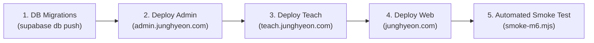

# Production Deployment Runbook — Tiếng Hàn JungHyeon Monorepo

> **Architecture**: Turborepo Monorepo (3 Deployable Next.js 14 Apps + 9 Shared Packages)  
> **Backend Authority**: Single Supabase Project (`auth.users`, unified DB, single RLS registry)  
> **Active Surfaces**:
> 1. `apps/web` $\rightarrow$ `junghyeon.com` (Learners & Guests)
> 2. `apps/teach` $\rightarrow$ `teach.junghyeon.com` (Teacher Studio)
> 3. `apps/admin` $\rightarrow$ `admin.junghyeon.com` (Back-Office & `/system/**` Area)

---

## 1. Domain & DNS Configuration

| Surface | Production Subdomain | Staging Subdomain | Vercel / Target Project | Robots / Indexability |
| :--- | :--- | :--- | :--- | :--- |
| **Learner Hub** | `junghyeon.com` / `www` | `web.staging.junghyeon.com` | `junghyeon-web` | **Indexable** (`index, follow`) |
| **Teacher Studio** | `teach.junghyeon.com` | `teach.staging.junghyeon.com` | `junghyeon-teach` | **NOINDEX** (`noindex, nofollow, noarchive`) |
| **Back-Office Admin** | `admin.junghyeon.com` | `admin.staging.junghyeon.com` | `junghyeon-admin` | **NOINDEX** (`noindex, nofollow, noarchive`) |

### Cloudflare / DNS Records
```dns
# Production CNAME / A Records
junghyeon.com.              CNAME   cname.vercel-dns.com.
www.junghyeon.com.          CNAME   cname.vercel-dns.com.
teach.junghyeon.com.        CNAME   cname.vercel-dns.com.
admin.junghyeon.com.        CNAME   cname.vercel-dns.com.

# Staging CNAME Records
web.staging.junghyeon.com.   CNAME   cname.vercel-dns.com.
teach.staging.junghyeon.com. CNAME   cname.vercel-dns.com.
admin.staging.junghyeon.com. CNAME   cname.vercel-dns.com.
```

---

## 2. Supabase Unified Project Setup

All 3 surfaces connect to **one single Supabase project**:

1. **Authentication Redirect URLs (`Authentication -> URL Configuration`)**:
   - Site URL: `https://junghyeon.com`
   - Additional Redirect URLs:
     - `https://*.junghyeon.com/**`
     - `https://*.staging.junghyeon.com/**`
     - `http://localhost:3000/**`
     - `http://localhost:3001/**`
     - `http://localhost:3002/**`

2. **Custom Claims Hook (`supabase/migrations`)**:
   - Generates `app_metadata.role` and `app_metadata.surfaces` on every JWT issue.
   - Database RLS remains the authoritative enforcement layer.

3. **Cross-Subdomain SSO Cookie Environment Variables**:
   - **Production**: `NEXT_PUBLIC_COOKIE_DOMAIN=.junghyeon.com`
   - **Staging**: `NEXT_PUBLIC_COOKIE_DOMAIN=.staging.junghyeon.com`
   - **Localhost**: Leave empty (`undefined`) so browsers store cookies as host-only (RFC 6265 §8.5 shares host-only cookies across ports `3000`, `3001`, `3002`).

---

## 3. Environment Variable Matrix

| Variable | `apps/web` | `apps/teach` | `apps/admin` | Secret Type |
| :--- | :---: | :---: | :---: | :--- |
| `NEXT_PUBLIC_WEB_URL` | Required | Required | Required | Public URL |
| `NEXT_PUBLIC_TEACH_URL` | Required | Required | Required | Public URL |
| `NEXT_PUBLIC_ADMIN_URL` | Required | Required | Required | Public URL |
| `NEXT_PUBLIC_COOKIE_DOMAIN` | Required | Required | Required | Public Domain |
| `NEXT_PUBLIC_SUPABASE_URL` | Required | Required | Required | Public Endpoint |
| `NEXT_PUBLIC_SUPABASE_ANON_KEY` | Required | Required | Required | Public Client Anon Key |
| `SUPABASE_SERVICE_ROLE_KEY` | **FORBIDDEN** | Required | Required | Server Secret |
| `PAYOS_API_KEY` / `CHECKSUM` | **FORBIDDEN** | **FORBIDDEN** | Required | Private Payment Secret |
| `STRIPE_SECRET_KEY` | **FORBIDDEN** | **FORBIDDEN** | Required | Private Payment Secret |
| `ADMIN_BOOTSTRAP_EMAIL` | **FORBIDDEN** | Optional | Required | Admin Provisioning |

---

## 4. Zero-Downtime Deployment Sequence

To prevent schema mismatch and broken sessions, follow this exact sequence:



1. **Step 1: Database Migrations (`supabase db push`)**:
   - All migrations must be **additive** (add nullable columns, add new tables, add RLS policies).
   - Never drop columns or rename active tables in the same deployment step.
2. **Step 2: Deploy `apps/admin` (`admin.junghyeon.com`)**:
   - Validates that back-office operations and `/system/**` privileged area can read new columns.
3. **Step 3: Deploy `apps/teach` (`teach.junghyeon.com`)**:
   - Enables teachers to draft new curriculum structures.
4. **Step 4: Deploy `apps/web` (`junghyeon.com`)**:
   - Deploys updated learner-facing components.
5. **Step 5: Post-Deploy Automated Smoke Test**:
   - Run `node packages/testing/scripts/smoke-m6.mjs` against staging or production endpoints.

---

## 5. Rollback & Emergency Protocols

1. **Atomic Frontend Rollback**:
   - In Vercel / container orchestrator, roll back to the previously pinned deployment ID with 1 click. Instant ($\approx 2$ seconds).
2. **Emergency Write Freeze**:
   - If database inconsistency occurs, navigate to `https://admin.junghyeon.com/system/maintenance` (requires `super_admin` + 2FA + Step-Up Re-Auth $\le 15\text{m}$).
   - Type `MAINTENANCE-MODE` to freeze learner mutations while leaving static reading active.
3. **Point-In-Time Database Restore (PITR)**:
   - Supabase automated daily backups and WAL archives allow restoration to any second within the retention window.
   - Review `/system/backups` for verified snapshot checksums.
