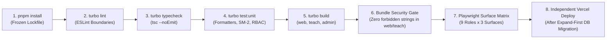

# Multi-Surface Deployment, CI/CD & Rollback Guide

> **Monorepo Tooling**: `pnpm` workspaces + Turborepo (`turbo.json`)  
> **Hosting**: 3 Independent Vercel Projects connected to 1 Git Repository + 1 Shared Supabase Project per Environment

---

## 1. Deployment Matrix

| App Workspace | Vercel Project Name | Root Directory | Build Command | Production Domain (`TODO: confirm`) | Staging Domain | Local Port |
| :--- | :--- | :--- | :--- | :--- | :--- | :--- |
| **`apps/web`** | `junghyeon-web` | `apps/web` | `pnpm turbo run build --filter=@junghyeon/web` | `junghyeon.com` | `staging.junghyeon.com` | `3000` |
| **`apps/teach`** | `junghyeon-teach` | `apps/teach` | `pnpm turbo run build --filter=@junghyeon/teach` | `teach.junghyeon.com` | `teach.staging.junghyeon.com` | `3001` |
| **`apps/admin`** | `junghyeon-admin` | `apps/admin` | `pnpm turbo run build --filter=@junghyeon/admin` | `admin.junghyeon.com` | `admin.staging.junghyeon.com` | `3002` |

---

## 2. CI/CD Pipeline (`.github/workflows/ci.yml`)

### Automated Security Gates in CI
1. **Cross-App Import Gate**: Fails immediately if any file under `apps/web` imports from `apps/teach` or `apps/admin` (or vice-versa).
2. **Forbidden Bundle String Gate**: Scans `.next/static` and `.next/server` of `apps/web` and `apps/teach` to verify zero occurrences of admin-only identifiers (`SUPABASE_SERVICE_ROLE_KEY`, `PAYOS_CHECKSUM_KEY`, `SEPAY_API_KEY`, `approveRefund`, `roles-matrix`, `impersonation-session`).
3. **Environment Schema Gate**: Each app runs its Zod environment validator (`packages/config/src/env.*.ts`) during build; if forbidden secrets are injected into `apps/web` or `apps/teach`, the build aborts.

---

## 3. Database Migration Strategy (Expand / Contract)

Because `apps/web`, `apps/teach`, and `apps/admin` deploy independently against a shared Supabase PostgreSQL database:
1. **Expand First**: New columns, tables (`role_surfaces`), enums (`surface_type`), and RLS helper functions (`in_surface()`, `has_permission()`) are added in backward-compatible migrations before application code depends on them.
2. **Deploy Apps**: `apps/web`, `apps/teach`, and `apps/admin` are deployed and verified.
3. **Contract Later**: Legacy columns or transitional redirects are removed only after all three surfaces have switched to the new schema.

---

## 4. Phase-by-Phase Migration & Rollback Plan (M-0 $\rightarrow$ M-9)

Every phase is tagged in Git prior to execution so rollback is instantaneous (`git checkout <tag>`):

| Phase | Pre-Phase Git Tag | Deliverable Summary | Zero-Downtime Rollback Strategy |
| :--- | :--- | :--- | :--- |
| **M-0** | `pre-m0-audit` | Full repository audit & architecture docs (`docs/surfaces.md`, `architecture.md`, `auth-sso.md`, `deployment.md`) | Documentation-only; no runtime impact |
| **M-1** | `pre-m1-skeleton` | `pnpm` + Turborepo skeleton; move app into `apps/web` unchanged | Revert root workspace config to single-app `package.json` |
| **M-2** | `pre-m2-packages` | Extract `@junghyeon/ui`, `content-renderer`, `features`, `rbac`, `auth`, `db`, `i18n`, `config` | Workspace aliases point back to `apps/web/src/*` |
| **M-3** | `pre-m3-admin` | Create `apps/admin` (port `3002`); keep transitional redirects on `apps/web/admin/*` | Toggle `NEXT_PUBLIC_ENABLE_EXTERNAL_ADMIN=false` |
| **M-4** | `pre-m4-teach` | Create `apps/teach` (port `3001`); move Teacher Studio routes out of `admin` | Toggle `NEXT_PUBLIC_ENABLE_EXTERNAL_TEACH=false` |
| **M-5** | `pre-m5-sso` | Cross-subdomain SSO cookies, middleware surface guard, surface switcher, 403 pages | Fallback to single-domain cookie |
| **M-6** | `pre-m6-system` | `/system/**` route group in `apps/admin` (`super_admin` + 2FA + 10m re-auth + impersonation) | Route alias fallback to `/settings/*` |
| **M-7** | `pre-m7-boundaries` | Enforce `eslint-plugin-boundaries`, bundle forbidden-string assertion, surface RLS policies | Revert RLS policy migration to previous tag |
| **M-8** | `pre-m8-deploy` | GitHub Actions CI/CD workflows, Vercel project configs, observability & runbook | Revert CI workflow |
| **M-9** | `pre-m9-hardening` | Full Playwright 11-persona $\times$ 3-surface e2e suite, API/RLS tests, Lighthouse $\ge 90$ | Final production release tag `v2.0.0-monorepo` |
