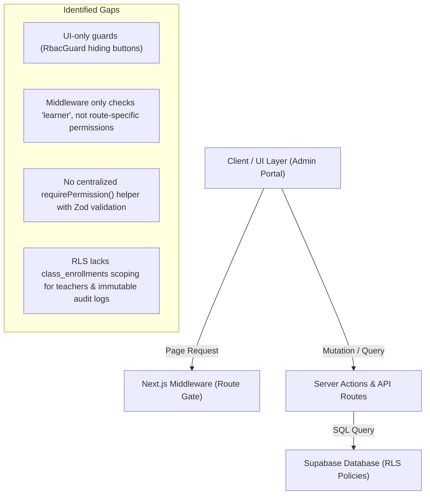

# RBAC & Security Audit: Admin Portal of Tiếng Hàn JungHyeon

**Audit Date**: November 2026  
**Status**: Step 1 Completed (Audit Findings & Gap Analysis)  
**Author**: Senior Full-stack Engineer & Security-minded Product Designer  

---

## 1. Executive Summary

This audit evaluates the current Role-Based Access Control (RBAC) architecture, authentication enforcement, data privacy (PII), and authorization layers across the Admin Portal of **Tiếng Hàn JungHyeon** (Next.js 14, Supabase, Tailwind, TypeScript).

### Key Risks Identified
1. **Unprotected API Endpoints**: Several `/api/admin/*` routes have either hardcoded role string comparisons (`actorRole === 'content_editor'`) or lack server-side authorization checks entirely.
2. **Missing Production Safeguards on Dev Persona Switcher**: The role switcher dropdown in [`AdminHeader.tsx`](file:///d:/TTJUNGHYEON/src/components/admin/AdminHeader.tsx) is rendered unconditionally, allowing any user on `/admin` to switch their client role to `Super Admin` via `localStorage`.
3. **Missing Critical Roles**: The platform lacks the dedicated `admin` and `marketing` roles, while using legacy fragmented names (`sales_lead`, `counselor`, `marketer`, `support`, `readonly`).
4. **PII and Revenue Exposure**: Student emails, phone numbers, and full revenue figures are delivered unmasked to non-privileged roles (e.g., teachers, marketing, support, and read-only observers).
5. **No Two-Person Rule on High-Impact Actions**: Authors can approve their own content drafts, refunds can be initiated without dual approval, and destructive actions lack re-authentication challenges.

---

## 2. Current Roles & Permissions Baseline

### 2.1 Role Discrepancies Across Codebase

| Environment / File | Defined Roles | Discrepancies & Deficiencies |
| :--- | :--- | :--- |
| **`src/features/auth-rbac/types.ts`** | `super_admin`, `content_editor`, `publisher`, `teacher`, `sales_lead`, `counselor`, `marketer`, `support`, `readonly` | Total 9 roles; lacks `admin`. Duplicates sales concepts (`sales_lead` vs `counselor`). Uses `readonly` instead of `read_only`. |
| **`src/components/admin/AdminHeader.tsx`** | `super_admin`, `content_editor`, `publisher`, `teacher`, `sales_lead`, `support`, `readonly` | Total 7 personas. Missing `admin` and `marketing`. |
| **Supabase DB (`20261102010000...sql`)** | `super_admin`, `content_editor`, `counselor`, `marketer`, `support` | Total 5 roles. Missing `admin`, `publisher`, `teacher`, `sales_crm`, `read_only`. |
| **Target Specification (Step 2)** | `super_admin`, `admin`, `content_editor`, `publisher`, `teacher`, `sales_crm`, `support_agent`, `marketing`, `read_only` | Canonical 9 roles with clear separation of duties. |

### 2.2 Permissions Discrepancies

- **Mixed Notations**: The codebase contains both dot notation (`content.read`, `sales.manage`) and colon notation (`content:read`, `crm:write`).
- **Missing Action Verbs**: Actions such as `approve`, `publish`, `refund`, `view_pii`, `view_revenue`, `impersonate`, and `manage_roles` are not formally defined as distinct database action entities.

---

## 3. Enforcement Points & Gap Analysis

### 3.1 Layer 1: Middleware (`src/middleware.ts`)
- **Current Behavior**:
  - Checks if `userRole === 'learner'` and redirects to `/vi/admin/unauthorized`.
  - Re-writes `/admin/*` paths and checks 2FA cookie if enabled.
- **Gaps**:
  - Does **not** check granular permissions per admin subpath. For example, a `content_editor` or `teacher` navigating directly to `/admin/sales/orders` or `/admin/settings/staff` is not blocked by middleware.
  - Does not supply a typed 403 response for unauthorized staff members navigating outside their permission boundaries.

### 3.2 Layer 2: Server Actions & API Routes (`src/app/api/admin/*`)
- **Current Behavior**:
  - `src/app/api/admin/content/route.ts`: Hardcoded check `if (actorRole === 'content_editor') return 403` on `publish`. Gaps: does not verify if author is approving their own draft; does not check other roles without publish permission.
  - `src/app/api/admin/marketing/route.ts`: **No role or permission checks**. Any caller can create coupons or change banners.
  - `src/app/api/admin/leads/route.ts`: **No authorization checks**. Allows public lead creation, but admin query endpoints are unprotected.
  - `src/app/api/admin/audit/route.ts`: Hardcoded `if (role === 'support' || role === 'learner') return 403`. Other roles like `content_editor` can view audit trails.
- **Gaps**:
  - Lack of a unified `requirePermission(resource, action, scope?)` utility.
  - Lack of input schema validation via Zod on admin mutation payloads.
  - Errors returned as generic strings rather than typed, structured error codes.

### 3.3 Layer 3: Database & Supabase RLS
- **Current Behavior**:
  - Functions `is_admin_user()` and `has_admin_permission(perm)` check `admin_users` and `role_permissions`.
  - Basic RLS enabled for `admin_roles`, `admin_permissions`, `audit_logs`, and `content_versions`.
- **Gaps**:
  - **Audit Logs Immutability**: `audit_logs` has an `INSERT` policy for staff, but lacks explicit policies rejecting `UPDATE` and `DELETE`.
  - **Draft Constraint**: No RLS policy preventing `content_editor` from inserting or updating content directly into `published` status.
  - **Teacher Scoping**: No RLS policy filtering learner records by `class_enrollments` for `teacher`.

### 3.4 Layer 4: Client & UI (`src/components/admin/*`)
- **Current Behavior**:
  - `RbacGuard`: Hides elements when `can(permission)` returns false.
  - `AdminSidebar`: Filters visible navigation items based on `item.permission`.
- **Gaps**:
  - **Security by Obscurity**: Reliance on hidden buttons rather than server-side rejection.
  - **Unmasked PII**: Learner emails and phone numbers are displayed unmasked across all tables.
  - **Unrestricted Revenue View**: All roles viewing the dashboard or analytics page can see raw revenue numbers.

---

## 4. Persona Switcher Audit

### 4.1 Mechanism
- Located in [`src/components/admin/AdminHeader.tsx`](file:///d:/TTJUNGHYEON/src/components/admin/AdminHeader.tsx).
- Sets `localStorage.setItem('junghyeon_admin_session', ...)` with the selected persona's mock permissions.
- Injects `activeRole` into [`AdminAuthContext.tsx`](file:///d:/TTJUNGHYEON/src/features/auth-rbac/AdminAuthContext.tsx).

### 4.2 Security Risks
1. **Exposed in Production**: Rendered without checking `process.env.NODE_ENV !== 'production'` or `process.env.ADMIN_DEV_PERSONA === 'true'`.
2. **Missing Real User Authorization**: Any user who reaches `/admin` can trigger the switcher, bypassing client-side RBAC guards.
3. **No Visual Warning Banner**: When switched to an alternate persona, there is no persistent banner indicating that actions are simulated.

---

## 5. Remediation Plan

To fulfill the requirements of Steps 2 through 7:
1. **Step 2 (Role Model)**: Standardize on 9 canonical roles (`super_admin`, `admin`, `content_editor`, `publisher`, `teacher`, `sales_crm`, `support_agent`, `marketing`, `read_only`). Seed database tables `roles`, `permissions`, `role_permissions`, and `staff_members`. Document the full matrix in `docs/admin-permissions.md`.
2. **Step 3 (3-Layer Enforcement)**:
   - Middleware route authorization with dedicated 403 page.
   - Unified `requirePermission()` server-side helper with Zod schemas.
   - Database migration with `has_permission(resource, action)` and immutability rules for `audit_logs`.
3. **Step 4 (Scope & Masking)**:
   - Server-side helpers: `maskEmail()`, `maskPhone()`, `maskName()`.
   - Teacher scoping to `class_enrollments`.
   - Revenue hiding for non-financial roles.
4. **Step 5 (Sensitive Actions & 2FA)**:
   - Block self-approval for authors.
   - Re-authentication modal for refunds, deletions, and role modifications.
   - Impersonation mode with 15-minute expiration and red banner.
5. **Step 6 (UI Overhaul)**:
   - Persona switcher gated behind `NODE_ENV !== 'production' && ADMIN_DEV_PERSONA === 'true' && isSuperAdmin`.
   - "Roles & Permissions" interactive matrix page with dry-run tester.
   - Staff directory with deactivation and 2FA tracking.
   - Learners page plan tabs aligned to Free and Lifetime VIP.
6. **Step 7 (Automated Test Suite)**:
   - Unit tests, Playwright end-to-end matrix tests, and SQL policy verification.
