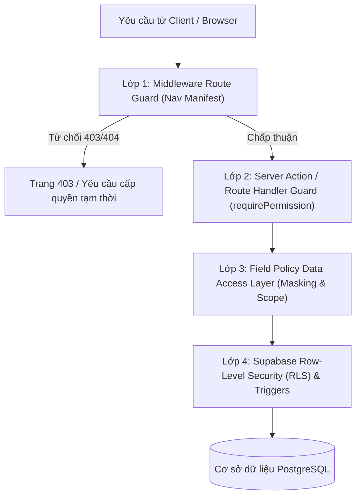

# Báo Cáo Kiểm Toán Toàn Diện RBAC & Bảo Mật Admin Portal (RBAC v2 Audit)

> **Dự án**: Nền tảng Học tiếng Hàn JungHyeon (`Tiếng Hàn JungHyeon`)  
> **Thời gian kiểm toán**: 03/11/2026  
> **Phiên bản kiến trúc**: RBAC v2 – Default-Deny & Role-Specific Workspaces  
> **Mục tiêu**: Phát hiện toàn bộ lỗ hổng lộ lọt dữ liệu (data leaks), các điểm chặn chỉ nằm ở UI (UI-only guards), sự xuất hiện của công cụ dev trên môi trường production, rò rỉ chỉ số kinh doanh nhạy cảm, và thiết lập nền tảng phân quyền thực sự theo vai trò.

---

## 1. Tóm Tắt Hiện Trạng & Sự Cố Được Xác Nhận (From Screenshot)

Trong phiên bản hiện tại, khi chuyển sang Persona mô phỏng **Chuyên Viên Hỗ Trợ (Support Agent)**, hệ thống vẫn xuất hiện các lỗ hổng nghiêm trọng sau:

1. **Rò rỉ toàn bộ menu sidebar không thuộc thẩm quyền của Support**:
   - Nhóm **Nội dung (Content)**: `Lessons (128)`, `Vocabulary`, `Roadmap Nodes` vẫn hiển thị đầy đủ kèm số lượng bài học hệ thống.
   - Nhóm **Học viên (Learners)**: `All Learners (2)` hiển thị danh sách duyệt toàn bộ người dùng thay vì chỉ cho phép tra cứu đích danh (lookup by ticket/email/phone).
   - Nhóm **Bán hàng (Sales)**: Menu `Orders & VIP` vẫn hiển thị và người dùng bấm vào được trang quản lý đơn hàng.
   - Nhóm **Tư vấn (Consulting)**: Menu `Leads Inbox (5)` vẫn hiển thị kèm số lượng leads chờ xử lý.
   - Nhóm **Cài đặt (Settings)**: Mục `UI Style Guide` (công cụ dev) vẫn xuất hiện trên sidebar.
   - Khối **Gói hội viên & Phân khúc (Plans / Segments)**: `Lifetime VIP 450`, `Free Plan 1`, `VIP Trial 120`, `Expired 45` hiển thị số liệu kinh doanh nhạy cảm cho nhân viên hỗ trợ.

2. **Rò rỉ dữ liệu tài chính & giao dịch tại trang `/admin/sales/orders`**:
   - **Tiêu đề trang làm lộ số liệu**: `Orders & VIP Packages · 142 Orders this month` tiết lộ tổng số lượng giao dịch của doanh nghiệp trong tháng.
   - **Bảng dữ liệu hiển thị toàn bộ danh sách đơn hàng**: Tên đầy đủ khách hàng (`Nguyễn Hải Đăng`, `Lê Phương Thảo`...), gói học phí, phương thức thanh toán cổng (`PayOS / VietQR`, `Chuyển khoản SePay`), trạng thái hoàn tiền (`Chờ duyệt hoàn tiền`), và cột `Thao tác hoàn tiền`.
   - **Cơ chế che giấu chỉ thực hiện hời hợt ở UI**: Chỉ dùng chuỗi `****** đ` để che cột số tiền nhưng toàn bộ cấu trúc dữ liệu, mã đơn hàng, thông tin khách hàng và luồng nghiệp vụ hoàn tiền vẫn bị tải về client và hiển thị.

---

## 2. Danh Mục Kiểm Toán Từng Thành Phần (Exhaustive Audit List)

### 2.1. Navigation Items & Badges (Thanh điều hướng Sidebar)

| ID Menu | Đường dẫn (href) | Nhóm (Group) | Phân quyền hiện tại | Badge / Count hiển thị | Rủi ro & Lỗ hổng phát hiện |
| :--- | :--- | :--- | :--- | :--- | :--- |
| `dashboard` | `/admin` | `overview` | Không có (Mọi role) | Không | Dùng chung 1 trang dashboard cho cả 9 role, chỉ ẩn/hiện vài widget. |
| `lessons` | `/admin/content/lessons` | `content` | `content.read` | `128` bài học | Rò rỉ số lượng bài học cho Support, Sales, Marketing. |
| `vocabulary` | `/admin/content/vocabulary` | `content` | `content.read` | Không | Support Agent truy cập được kho từ vựng và can thiệp nội dung. |
| `roadmap` | `/admin/content/roadmap` | `content` | `content.read` | Không | Support Agent xem được cây kiến thức nội bộ. |
| `publishing` | `/admin/publishing` | `content` | `content.review` | `3` bài chờ duyệt | Badge cảnh báo hiển thị cho các role không có quyền duyệt. |
| `all-learners` | `/admin/learners` | `learners` | `learners.read` | `1.900` hoặc `2` | Cho phép Support và Teacher duyệt toàn bộ danh sách học viên thay vì chỉ tra cứu hoặc xem lớp phụ trách. |
| `analytics` | `/admin/analytics` | `analytics` | `analytics.read` | Không | Hiển thị doanh thu và phễu chuyển đổi cho các role không cần thiết. |
| `orders` | `/admin/sales/orders` | `sales` | `sales.read` | Không | **LỖ HỔNG LỚN**: `support_agent` được gán alias `sales.read` nên xem được toàn bộ đơn hàng! |
| `leads` | `/admin/sales/leads` | `consulting` | `sales.manage` | `5` leads mới | Support Agent nhìn thấy số lượng và thông tin liên hệ của khách tiềm năng. |
| `ui-styleguide`| `/admin/design` | `settings` | Không có | Badge `UI` | **LỖ HỔNG DEV**: Trang thử nghiệm token/design vẫn mở công khai trên production! |
| `planSegments` | Khối sidebar phụ | `plans` | Không có | `450`, `1`, `120`, `45` | **LỖ HỔNG LỘ CHỈ SỐ**: Hiển thị số lượng hội viên VIP, Trial, Expired cho mọi tài khoản đăng nhập admin. |

---

### 2.2. Trang Quản Trị & Server Actions / API Routes

| Trang / Tuyến đường (Route) | Chức năng nghiệp vụ | Kiểm tra phân quyền ở đâu? | Lỗ hổng phát hiện & Hướng khắc phục |
| :--- | :--- | :--- | :--- |
| `/admin` | Dashboard trung tâm | Không có (Chỉ kiểm tra đăng nhập) | Cần chuyển sang **RoleHome(role)** độc lập: mỗi role chỉ thấy widget phục vụ công việc của mình. |
| `/admin/sales/orders` | Quản lý đơn hàng & VIP | UI check & alias `sales.read` | Chặn triệt để tại Middleware và Server Action. Chỉ cho phép `super_admin`, `admin`, `sales_crm`. Các role khác nhận mã **403/404**. |
| `/admin/learners` | Danh sách học viên | UI guard + RLS cơ bản | `support_agent` không được duyệt danh sách tổng; chỉ được tìm kiếm chính xác (search by ticket/email/phone). |
| `/admin/learners/[id]` | Chi tiết học viên | UI guard | Tab "Plan & purchases" của Support chỉ xem trạng thái gói, cấm xem số tiền, cổng thanh toán và mã giao dịch. |
| `/admin/design` | UI Style Guide | Không có guard | Gỡ bỏ hoàn toàn khi `NODE_ENV === 'production'` (trả về 404). |
| `/admin/settings/roles` | Ma trận phân quyền | Chỉ Super Admin | Đảm bảo chặn API route không cho Admin thông thường sửa quyền của Super Admin (Privilege Escalation). |
| API `/api/admin/orders` | Lấy dữ liệu đơn hàng | Check session token | Chưa áp dụng Field Policy: Server trả về cả amount, gateway id, customer phone về client rồi mới ẩn ở UI. |
| API `/api/admin/refund` | Duyệt / thực hiện hoàn tiền | Single-person check | Cần cơ chế **Kiểm soát kép (Two-Person Rule)**: `sales_crm` đề xuất $\to$ `admin` duyệt với xác thực lại mật khẩu/2FA. |

---

### 2.3. Lộ Lọt Chỉ Số Kinh Doanh (Business Metrics Leaks)

1. **Tiêu đề trang cứng chứa số liệu**:
   - `Orders & VIP Packages · 142 Orders this month`: Làm lộ số lượng đơn hàng bán ra trong tháng cho các nhân sự không thuộc bộ phận kinh doanh.
   - *Khắc phục*: Tách rời tiêu đề trang khỏi chỉ số (`Orders & VIP Packages`). Chỉ số chỉ tải qua component riêng được bảo vệ bởi capability `view_order_counts`.
2. **Khối phân khúc gói học viên (Plans Sidebar Block)**:
   - Hiển thị số lượng học viên `Lifetime VIP: 450`, `Trial: 120` ngay góc dưới sidebar cho tất cả người dùng.
   - *Khắc phục*: Ẩn hoàn toàn khối này đối với các role không có capability `view_segment_counts` (`support_agent`, `content_editor`, `teacher`, `read_only`).

---

### 2.4. Nguy Cơ Leo Thang Đặc Quyền (Privilege Escalation Risks)

1. **Dev Persona Switcher**:
   - Dropdown chuyển đổi persona đang lưu role vào cookie/session client-side. Nếu không được bảo vệ bằng cờ môi trường (`NODE_ENV !== 'production'`) và quyền thực tế của người dùng (`current_user.role === 'super_admin'`), kẻ tấn công có thể giả mạo cookie để chiếm quyền.
   - *Khắc phục*: Persona Simulator chỉ hoạt động khi thỏa mãn đồng thời:
     $$\text{NODE\_ENV} \neq \text{'production'} \land \text{ADMIN\_DEV\_PERSONA} = \text{true} \land \text{real\_role} = \text{'super\_admin'}$$
     Và ở chế độ mô phỏng, mọi thao tác ghi (mutations) đều bị khóa (Dry-run only).
2. **Quản lý quyền hạn (Role Assignment)**:
   - `admin` thông thường không được phép tạo hoặc phân quyền cho tài khoản khác vượt quá quyền của chính mình, và tuyệt đối không thể gán quyền `super_admin`.

---

## 3. Kiến Trúc Khắc Phục: Mô Hình 4 Lớp Bảo Vệ (Defense in Depth)

1. **Lớp 1 (Middleware)**: Kiểm tra route URL đối chiếu với `NavManifest`. Nếu role không sở hữu permission bắt buộc, trả về 403 ngay lập tức.
2. **Lớp 2 (Server Actions & API Handlers)**: Thực thi `requirePermission(resource, action, capability)`. Tuyệt đối không query dữ liệu trước khi kiểm tra quyền.
3. **Lớp 3 (Field Policy & Data Access Layer)**: Lọc các cột được phép đọc trước khi trả về. Tự động che giấu PII (email, phone, revenue) trên server nếu thiếu capability `view_pii` hoặc `reveal_pii`.
4. **Lớp 4 (Supabase RLS & Database Triggers)**: Bảo vệ trực tiếp tại database với hàm `has_permission()` và kiểm tra ràng buộc chống sửa DANGER permissions.
